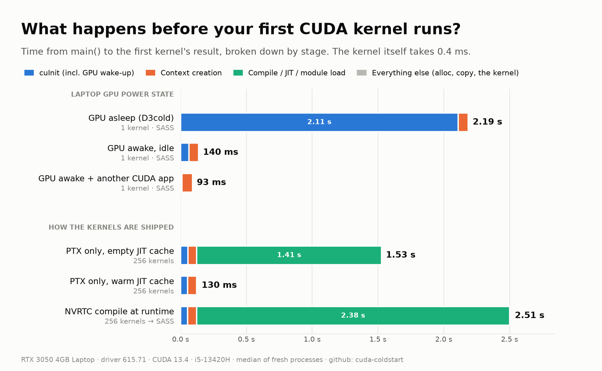
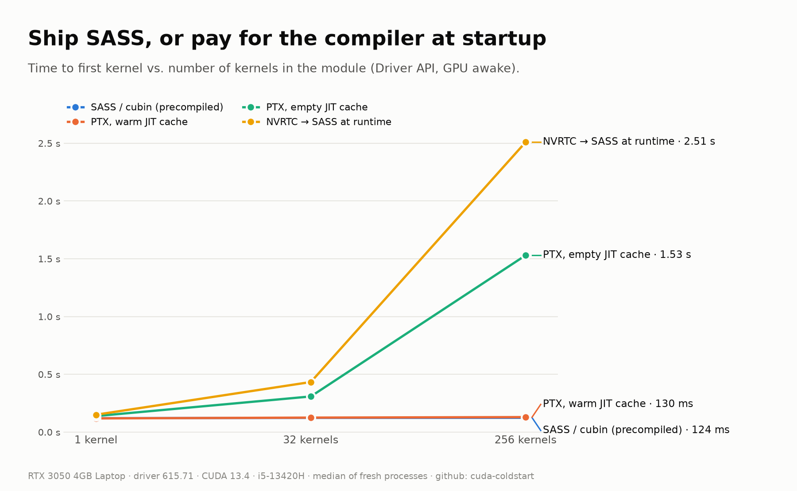
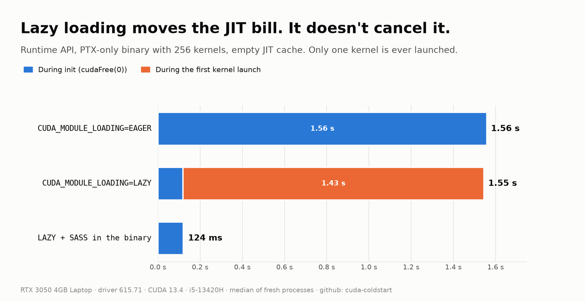

# cuda-coldstart

**What happens between `main()` and your first CUDA kernel's result, and how long does each step take?**

The kernel in this benchmark takes **0.4 ms**. On a laptop, getting to it can take **2.2 seconds**.



## Findings

Measured on an RTX 3050 4GB Laptop GPU (driver 615.71, CUDA 13.4, i5-13420H, Linux 7.2). All numbers are medians of fresh processes; see [Method](#method).

### 1. A sleeping laptop GPU costs ~2 s, and `cuInit()` pays for it

With runtime D3 power management, the NVIDIA driver powers the dGPU off when nothing uses it (here, after roughly 20 s idle). The first `cuInit()` has to wake it.

| GPU state before the process starts | `cuInit` | time to first kernel |
|---|---:|---:|
| Asleep (D3cold) | **2110 ms** | 2.19 s |
| Awake, no other CUDA process | 64 ms | 140 ms |
| Awake, another process holds a CUDA context | **9.5 ms** | 93 ms |

Driver API, 1 kernel, n = 8 per state. Runtime API shows the same picture: 2.28 s / 134 ms / 94 ms for `cudaFree(0)`.

So "the first run is slow" on a laptop is often not CUDA at all, but power management. That matters for benchmarks, CLI tools and short-lived jobs.

### 2. Shipping PTX only means the driver compiles your kernels at startup

A module with 256 kernels:

| How the kernels are shipped | load / compile | time to first kernel |
|---|---:|---:|
| SASS (cubin for sm_86) | 2.1 ms | 124 ms |
| PTX, warm JIT cache | 4.9 ms | 130 ms |
| PTX, empty JIT cache | **1406 ms** | 1.53 s |
| NVRTC → SASS at runtime | 2375 ms | 2.51 s |
| NVRTC → PTX, then driver JIT | 935 + 1413 ms | 2.50 s |



The JIT cost grows with the amount of device code in the module, not with the number of kernels you actually launch. The JIT cache (`~/.nv/ComputeCache`) hides this on your machine. Fresh containers and CI runners start with an empty cache every time.

### 3. Lazy loading doesn't save you from PTX JIT

`CUDA_MODULE_LOADING=LAZY` (the default since CUDA 12.2) defers loading until a kernel is first used. With a PTX-only binary, the first launch of **one** kernel still JIT-compiles the whole module:



| PTX-only, 256 kernels, empty cache | init | first launch | total |
|---|---:|---:|---:|
| EAGER | 1558 ms | 0.4 ms | 1.56 s |
| LAZY | 118 ms | 1427 ms | 1.55 s |
| LAZY + SASS in the binary | 120 ms | 3.2 ms | 0.12 s |

Lazy loading moves the bill from init to the first launch. Embedding SASS for your target GPU is what actually removes it.

### 4. Once warm, Runtime vs Driver API launch overhead is the same

Empty kernel, 5 runs × 20k launches:

| API | enqueue / launch | launch + sync (p50) |
|---|---:|---:|
| `kernel<<<>>>` | 1.1 – 1.6 µs | 4.1 – 4.8 µs |
| `cudaLaunchKernel` | 1.1 – 1.6 µs | 4.0 – 4.8 µs |
| `cuLaunchKernel` | 1.1 – 1.6 µs | 4.0 – 4.7 µs |

Within run-to-run noise. Choose between the two APIs for control, not for launch speed.

## Practical takeaways

- **Build SASS for the GPUs you deploy on**, e.g. `-gencode arch=compute_86,code=sm_86`, and keep a PTX target only as a fallback for future GPUs.
- **Persist the JIT cache** (`CUDA_CACHE_PATH`) in containers and CI if you rely on PTX or JIT-generated kernels.
- **Benchmark with a warm-up**, and on laptops know whether your first run included waking the GPU.
- If first-call latency matters (CLI tools, serverless, interactive apps), **initialize CUDA early** or keep the GPU awake (a long-lived process or persistence mode).

## Method

- Every cold-start measurement is a **fresh process**. Configurations run **round-robin in shuffled order** (15 rounds), so thermal drift and background noise spread across all configs. A discarded warm-up round fills the OS page cache and primes the "warm" JIT caches.
- The JIT cache is controlled explicitly: `CUDA_CACHE_DISABLE=1` for cold, a per-config `CUDA_CACHE_PATH` for warm.
- `bench_driver` **`dlopen()`s libcuda and libnvrtc** instead of linking them, so loading the driver library is measured as a stage (≈1 ms) instead of hiding in process startup.
- Kernels are generated (`gen_kernels.py`): each is a fully unrolled FMA/`__sinf` chain with its own constants, so the compiler can't merge them. 1, 32 and 256 kernels per module.
- The wake experiment (`run_wake.py`) polls `/sys/bus/pci/devices/<gpu>/power/runtime_status` and starts the process only once the GPU is `suspended`. The "another CUDA process" state uses `hold_gpu`, which keeps a context open.
- No other CUDA processes were running (recorded in `results/env_main.json`).

### Limitations

- One laptop, one driver version. Desktop and server GPUs with persistence mode enabled won't pay the wake-up cost. That contrast is part of the point.
- The OS page cache was warm. A first run right after boot also pays disk I/O; `libnvrtc` alone took ~180 ms when uncached.
- Each process spends ~90 ms outside the measured stages (exec, dynamic linking, CUDA teardown at exit). It shows in `process_wall` in the raw data but isn't broken down.
- JIT cost depends heavily on how much code the kernels contain; the synthetic kernels here are moderately heavy, not representative of any specific library.

## Reproduce

Requirements: CUDA toolkit (nvcc, NVRTC), clang++, Python 3, an NVIDIA GPU. Set `SM` in the Makefile to your GPU's compute capability.

```sh
make                          # build benchmarks + generated kernels
python3 run_bench.py          # ~5 min, results/summary_default.csv
python3 run_wake.py           # laptops only; ~6 min of waiting for the GPU to sleep
python3 -m venv .venv && .venv/bin/pip install matplotlib
.venv/bin/python make_charts.py   # expects the 'main' tag; see TAG in the script
```

Stop other GPU processes first (`nvidia-smi` should list none).

## Layout

```
src/bench_driver.cc    Driver API + NVRTC cold start, stage by stage
src/bench_runtime.cu   Runtime API cold start (SASS vs PTX-only builds)
src/bench_launch.cu    steady-state launch overhead, three APIs
src/hold_gpu.cc        holds a context open ("another CUDA app")
gen_kernels.py         generates N distinct kernels
run_bench.py           main benchmark runner
run_wake.py            GPU power-state experiment
make_charts.py         figures in results/figures/
results/               raw data (jsonl), summaries (csv), env, figures
```
